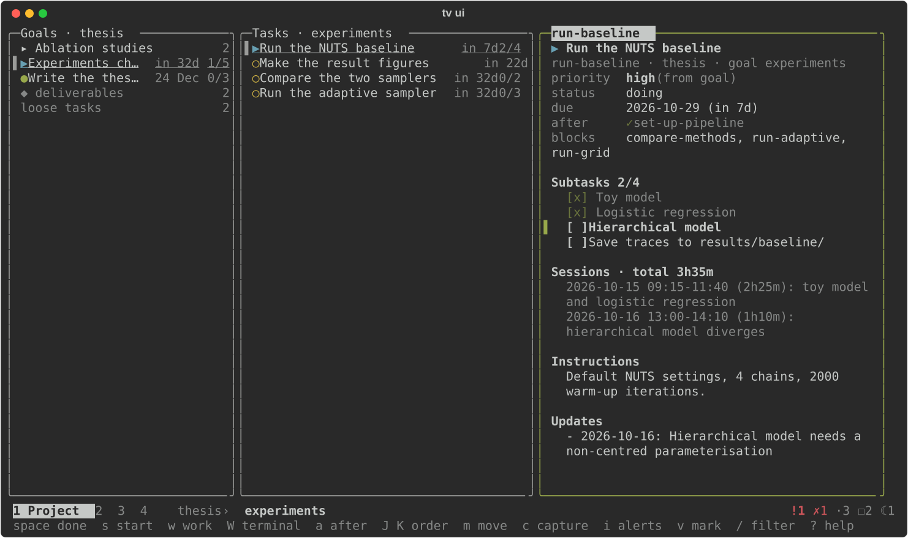
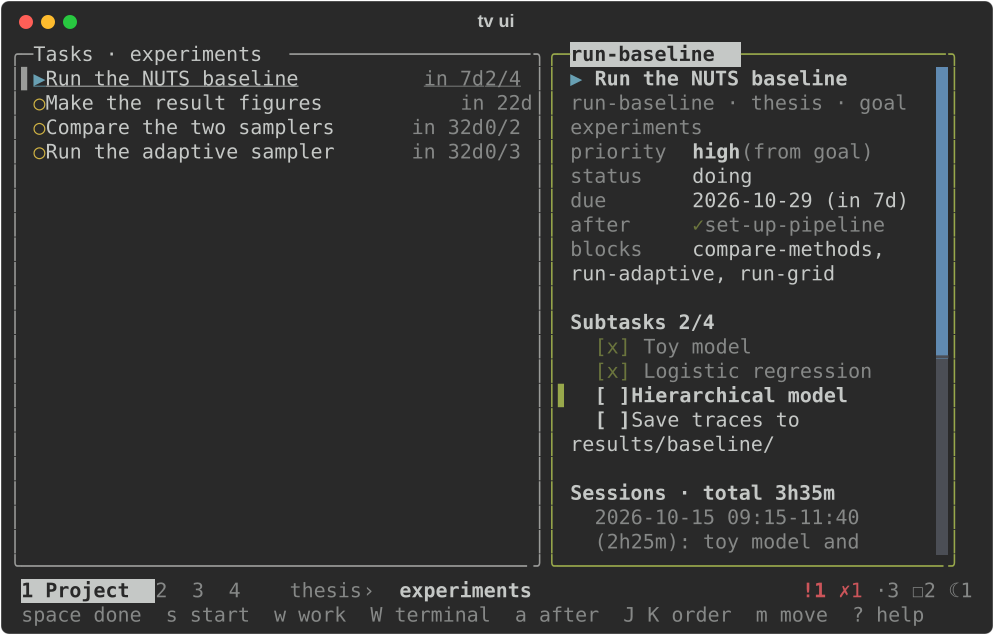

# The full-screen view

`tv ui` (or just `tv` in a terminal) opens a drill-down view of everything:
columns of goals, tasks and the item's detail, with one row of status at the
top and one row of keys at the bottom. It is made to sit open in a tmux pane
all day.



The left column is the **scope** you are in, chosen with `1`-`4` (or `tab`):

| Key | Scope | The left column holds |
|---|---|---|
| `1` | project | the project's `▸` subprojects, its goals, then `◆ deliverables` and `loose tasks` |
| `2` | next | the `next` ranking, then goals with no tasks yet |
| `3` | inbox | `IDEAS` (from `inbox.md`), then `CHORES` (from `todo.md`) |
| `4` | agenda | the `status` report, today's chores, then everything dated |

In the project scope two more columns follow: the selected goal's **tasks**,
and then the **preview** of whatever is selected. Selecting a task fills the
preview with its dependencies, subtasks, work sessions and notes; selecting a
goal shows its flow board.

The header starts with the four scopes as tabs (the current one highlighted), then says where you are (`thesis › experiments`), what you are working
on and for how long, what needs attention (overdue, blocked, ideas, todos,
stale projects), and when it last reloaded. The hint line below the columns
says what the keys do where the cursor is.

## Moving around

`enter` on a `▸` subproject opens it, and `h` (or `esc`) in its goal column
goes back to the parent with the cursor on the subproject you came from. The
breadcrumb shows the parents (`relu › nips`). A subproject's own goals and
tasks live only in it, so a project made of subprojects lists just those.

Vim motions mean exactly what they mean in vim: `h`/`l` and `←`/`→` move a
column left or right, `j`/`k` and `↑`/`↓` a row, `g`/`G` the first or last
row, `ctrl-d`/`ctrl-u` and `ctrl-f`/`ctrl-b` by half and full pages, `H`/`M`/`L`
to the top, middle and end of the viewport. `enter` (or `l`) descends into the
next column; `esc` (or `h`) comes back one, or clears the filter, or leaves
the preview.

## Keys

Press `?` inside for the full list; the bottom line always shows the keys for
where the cursor is. Five keys deliberately differ from vim and each is named
in the help:

| Key | What it does |
|---|---|
| `space` | done (goals, tasks, todos, and a subtask in the preview; an idea: done already, removed) |
| `x` | reopen — vim's `x` deletes a character |
| `s` | start: mark doing |
| `w` | work on the task (`tv work`); on the task you are working on, pause |
| `i` | jump to the next overdue, blocked or stale item (in the agenda) |
| `W` | open the task in a terminal of its own (`tv work -t`; a subtask in the preview); closing it marks it done |
| `n` | note in `## Updates` (on a project: a log line) |
| `o` / `O` | add at the cursor's level / one level up (task, goal, project, …) |
| `e` | open in `$EDITOR`; validated and committed when you return |
| `t` | due date / deadline (`today`, `+3d`, `fri`, `2026-11-01`; `none` clears) |
| `!` | cycle priority high → med → low |
| `m` | move to another project or goal (only reachable homes are offered) |
| `p` | promote an idea or chore to a task (scope 3); elsewhere it pastes nothing |
| `T` | triage: empty the inbox one item at a time (see below) |
| `D` | drop (asks first; refused while other tasks depend on it) |
| `u` | undo the last change (asks, and names it) |
| `v` / `V` | mark a row / mark the whole column · with no marks: show done items |
| `J` / `K` | move the row down / up — writes `order:` (see below) |
| `a` / `A` | add / remove an `after` dependency, picked from the task's board |
| `@a` `@d` `@m` `@l` | people: add · remove · mail · list |
| `/` | filter every column at once (`esc` clears) |
| `f` | flow board, full screen (`f` again: the same cards by status) |
| `P` | pick the project (subprojects are indented under their parent) |
| `r`, `ctrl-p`, `q` | reload, command palette (themes), quit |

## Symbols

| Symbol | Meaning |
|---|---|
| `●` | ready: can be started now |
| `▶` | doing (in the header: the task you are working on) |
| `○` | waiting on tasks that aren't done (`after`) |
| `✗` | blocked |
| `✓` | done |
| `[ ]` / `[x]` | subtask open / ticked |
| `◆` | deliverable |
| `☾` | project with no activity for a while |
| `▣` | open task terminals (`W`) |

`?` lists them too.

Every picker (`P`, `m`, `p`, `a`, `@a`, …) filters as you type: `rel` keeps
the rows whose id or title contains it, and a subproject also matches its
parent's id. `↑`/`↓` (or `ctrl-n`/`ctrl-p`) move, `enter` takes the highlighted
row, and `esc` clears what you typed, then closes. Letters are always text
there, so `j` and `k` don't move.

## Emptying the inbox: triage

`T` goes through the inbox one item at a time, one kind per pass: the chores
(`todo.md`), then the ideas (`inbox.md`). It starts with the kind under the
cursor; `c`, `i` and `f` switch to chores, ideas, or the ideas filed under
projects and goals, and the top line counts what each pass has left. One key
decides each item, and the next one appears:

| Key | The item becomes |
|---|---|
| `t` | a task: pick `project` (no goal) or `project › goal`, then edit the title |
| `g` | a goal in a project you pick |
| `P` | a project, top-level or under one you pick |
| `s` | a subtask of a task you pick |
| `l` | an idea filed under a project or goal, for later |
| `x` | nothing: it was done already (a chore is ticked off, an idea removed) |
| `D` | nothing: dropped |
| `n` / `b` | skip / back one |
| `u` | undo the last change |

`#tags` in the text become the new item's tags. Each decision is one commit
that removes the item and creates what it became, and the place you used last
is listed first next time. When a pass is empty, `enter` starts the next.

## Marking several rows

`v` marks the row under the cursor and `j`/`k` extend the marks; `V` marks the
whole column, and `space`, `x`, `s`, `!`, `m`, `D` and `@a` then act on all of
them. Each marked row is still **its own commit** — so `u` takes a bulk change
back one item at a time. Only a verb over more than three marked rows asks
before it runs.

## Search

`/` filters every column at once. A column shows the matching rows and keeps
the parents of a match, so a task you searched for still shows the goal it
belongs to; a dim `… N hidden by the filter` line counts what went, and the
header shows the term. `esc` clears it.

## The flow board

`f` opens the same board `tv flow` draws, full screen. `f` inside switches
between the staged view and the status (kanban) columns, `j`/`k` scroll, and
`enter` jumps back into the hierarchy at the card you are looking at.

## Ordering: `J`, `K` and `order:`

`J` and `K` move a row and write an `order:` number into the task files
(0, 1, 2, …), one commit for the whole rewrite. That number is what the CLI
uses too, so the order you arrange here is the order `tv task list`, `tv next`
and `tv flow` show:

```yaml
id: draft-methods
goal: write-up
order: 0        # first in this goal's list, whatever its priority
```

A task without `order:` sorts after the numbered ones, by priority and due
date as before, so nothing changes until you rearrange something. `order:`
arrives with content layout v3: run `tv migrate` once after updating (it only
bumps the version; nothing is rewritten). `tv task edit ID --order N` sets it
by hand, and `J`/`K` work inside a goal, in a project's loose list, and on a
task's subtasks in the preview.

## Starting point

The app opens on the project linked to your current folder (`tv project link`),
else the project of the task you are working on, else the project you had open
last, else the first active one. `P` picks another any time.

## Staying up to date

The view reloads by itself within a couple of seconds whenever something
commits to the content repo: the CLI in another shell, `tv undo`, an editor,
or a `git pull`. `r` reloads now, and the `↻` in the header says when it last
did.

## Small terminals

Below 100 columns the leftmost column is dropped and the header keeps it as a
breadcrumb: at 80 columns you have `TASK | preview` with `thesis › experiments`
above. When the header gets tight, only the current scope keeps its name
(`1 Project  2  3  4`) and the alerts shrink to counts (`!1 ✗1 ·3 ☐2 ☾1`:
overdue, blocked, ideas, todos, stale), so the breadcrumb stays readable.
Below 40×12 it asks for a bigger window.



Colours come from your terminal's own palette, so it matches your theme, light
or dark. The row you are on is reversed and has a `▌` bar at its left edge, in
the accent colour in the column you are in and dim in the others, so you can
still see where you came from. `NO_COLOR` is respected; focus and selection
are still shown by the bold column title, the bar and the reversed row.
